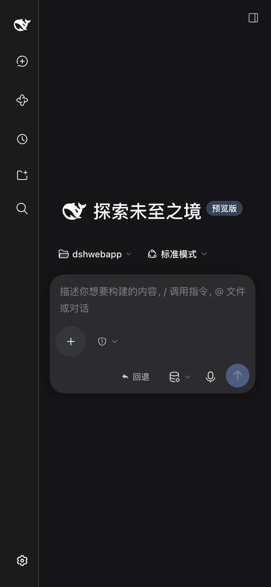
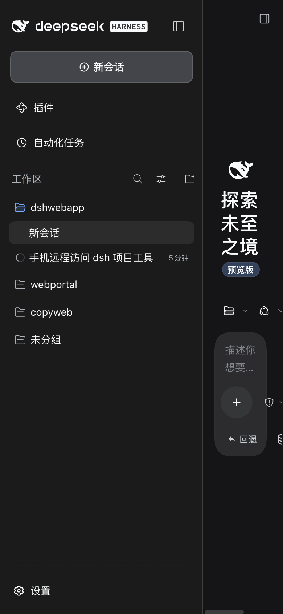

# dsh-remote

把本机的 DeepSeek Harness 接到任何地方。

装一个插件，在 dsh 的**设置 → 远程访问**里填一台服务器（或者什么都不填，用 Cloudflare），手机就能在任何网络下打开 dsh 本身——同一份工作区、同一份聊天记录，不是第二份副本。

<p align="center">
  
  
</p>

手机浏览器（390×844）实测截图。左边是展开的工作区与会话列表，右边是聊天。界面就是 dsh 自己的 Web GUI，插件没有另造一层。

> **English**: a dsh plugin that makes this machine reachable from anywhere. Configure a relay (SSH reverse tunnel, or a zero-config Cloudflare tunnel) from dsh's own Settings page; your phone then opens the real dsh web GUI — the same runtime, the same workspaces and transcripts, not a second view of them. `dsh plugin --profile desktop add github:Guuu16/dsh-remote`

---

## 安装

**方式一：从 GitHub 装（推荐）**

```sh
dsh plugin --profile desktop add github:Guuu16/dsh-remote
```

装完重启一次 dsh。

**方式二：本地目录装**

```sh
git clone https://github.com/Guuu16/dsh-remote.git ~/dsh-remote
dsh plugin --profile desktop add ~/dsh-remote
```

也可以在 dsh 的插件页面里，用「安装 bundle」指向这个目录。

**要求**：Node ≥ 22.15（用到内置的 zstd 解压）。云隧道模式首次会自动下载 `cloudflared` 到 `~/.dsh-remote/bin/`，不需要 brew，也不需要账号。

---

## 配置

重启后打开 **设置 → 远程访问**（跟语言、外观并列的那一页）。里面是六个字段：

| 字段 | 说明 |
|---|---|
| 方式 | `关闭` / `SSH 反向隧道` / `Cloudflare 隧道` |
| 服务器地址 | SSH 方式必填，域名或 IP |
| 用户名 | SSH 方式必填 |
| 密码 | 只在首次用于装公钥；装完自动从磁盘清掉，之后走密钥 |
| SSH 端口 | 默认 22 |
| 服务器上暴露的端口 | 默认跟网关同端口 |

保存后页面会显示网关状态、隧道状态、访问密钥、局域网地址和公网地址——隧道连上以后公网地址会自己出现，不用刷新。

### 三种方式怎么选

**Cloudflare 隧道**——零配置，不用服务器、不用开端口、不要账号。`cloudflared` 从你机器**主动出站**连到 Cloudflare 边缘，换回一个 `*.trycloudflare.com` 的临时 HTTPS 域名。代价：流量过 Cloudflare 边缘，域名每次重连都换；边缘通常就近接入，但如果你本机挂了全局代理出国，它会绕远，首次加载 GUI 可能要等一分钟（那 3.9 MB 的插件包要过一遍中继，之后就吃浏览器缓存了）。

**SSH 反向隧道**——用你自己的服务器，延迟低。需要两件事：服务器 `sshd_config` 里 `GatewayPorts clientspecified`（否则转发的端口只绑 relay 的 `127.0.0.1`，外面连不上），以及云平台安全组放行那个端口。

**关闭**——只在局域网可用。手机和电脑同一个 WiFi 时仍然能访问。

### SSH 那步插件会替你做什么

填了密码点保存之后：`ssh-copy-id` 把本机公钥装到服务器 → 验证密钥能登录 → **把密码从磁盘清掉** → 建立 `ssh -R` 隧道并保持（断线每 5 秒重拨）。密码只在第一次用一次。

---

## 手机上怎么用

**扫码，不用输任何东西。**设置页和配置页在每个地址旁边都画了一个二维码，手机相机对着扫就直接打开——包括局域网那条和公网那条。

打开之后，Safari / Chrome 里「添加到主屏幕」，之后就是一个全屏 app：没有地址栏，图标是你自己的。这一步靠 manifest 和 `apple-touch-icon` 完成，图标是插件自带的 PNG（180/192/512 三档，iOS 不认 SVG）。

手上有密钥也可以手动拼地址：

```
https://xxx.trycloudflare.com/?k=<access-key>
```

第一次带 `?k=` 会换成一个 HttpOnly cookie（30 天），之后地址栏是干净的。

**局域网那条最快**，但**地址是路由器分配的，换网络或隔久了会变**。变了一扫码就是新的，不用管旧链接。

**访问密钥是唯一的门禁**：32 字节随机值，没有它任何请求都是 401，连 `/api` 的 WebSocket 升级也会被拒。本机 loopback 免密钥——能在本机发请求的进程本来就有文件系统权限。换密钥就在设置页上，一按所有已配对设备立刻失效。

手机上看到的就是 dsh 自己的界面：左上角"打开侧边栏"进出工作区和会话，右边是聊天。我只在它上面加了两件它自己不会做的事——图标栏按钮的触摸高度和刘海/底部安全区的 padding。**横向一指不碰**：曾经试着把侧栏改成浮层，实测把对话面板的定位搞坏了（面板变成 x=320、宽 390），所以布局留给 dsh 自己。这些样式只在小屏生效，同一个网关下桌面浏览器看到的是原样。

---

## 项目：侧边栏漏掉的那些

**这是这个插件存在的最实际的理由。**

dsh 的侧边栏列的是**工作区**，不是"有历史记录的目录"。这两个概念是分开的：注册表里没登记过的目录，历史再多也不显示。实测这台机器上 `~/.dsh/sessions` 里有 5 个目录，而侧边栏只有 3 个——`dsh`（4 个会话）和 `moneymoney`（2 个会话）**完全看不见**，连进去的办法都没有。

设置页里那张项目卡把两边的差集算出来给你看，一个按钮补齐。它用的是 dsh 自己的 API，不是猜的：

- `sessionQuery.listSessions()` —— 每个会话头都带 `cwd`，这是"磁盘上到底有哪些项目"的权威答案
- `workspaceRegistry.list()` —— 已登记的工作区
- 两者的差集就是要补的

补齐调 `workspaceRegistry.create()`，它会走 `realpath` 且**幂等**，所以已登记的路径是无操作、目录已删的自己会报错。**会话不需要一个个挂上去**：`Workspace.sessionIds` 是按 canonical cwd 自动过滤的，所以注册目录之后历史会话自己就归属过去了。

卡上还会标出**目录已经不存在**的工作区（`status()` 返回 `missing-dir`）。

**默认不自动执行**——它写的是你的持久工作区注册表。想要启动时自动补，卡片上有个开关，打开后启动 5 秒跑一次。**手上有密钥的人也不会因为它而被改数据**：那个按钮在设置页里，不在公网可达的那一页上。

---

## 它是怎么做到的

**同一个运行时，不是镜像。** 插件在 dsh 进程里再起一个绑 `0.0.0.0` 的 HTTP 服务，把请求代理到 dsh 自己那个只绑 loopback 的端口。所以手机上看到的每个工作区、每条消息都是同一个 `~/.dsh`、同一个进程——不是同步、不是缓存、不是第二份副本。

**绕过两道门。** dsh 拒绝 `--host 0.0.0.0`（源码里写明"会把远程代码执行暴露到网络"），所以插件不动它，自己开一个 listener。它的 `/api` 信任围栏只接受 loopback 或已声明的 authority，并要求 `Origin` 与 `Host` 一致，所以代理转发时把两者一起改写成 loopback authority，并注入一张自己签的 cookie——签名密钥持久存在 `~/.dsh/.credentials.yaml`，插件读它就能签出合法 cookie，不需要去抓进程启动时打印的 launch token。

**WebSocket 要单独照顾。** dsh 的 RPC 全走 `/api/remote.mux` 的 WebSocket。`Connection: Upgrade` 和 `Upgrade` 是 hop-by-hop 头，正常转发时会被丢掉——丢了以后升级请求退化成普通 GET，上游永远不触发 upgrade 事件，客户端只看到 socket 挂死（dsh 自己的 GUI 会每 5 秒重连一次 `[connection] connection lost`）。所以升级路径要显式重建这两个头，socket 到 socket 直通。

**HTML 不能当纯文本改。** dsh 的 index 是 gzip 出去的。不先解压就注入、又留着 `content-encoding`，浏览器直接 `ERR_CONTENT_DECODING_FAILED` 白屏。注入前解码、注入后删掉该头。另外中间如果隔着 Cloudflare，它会给 HTML 注入 `email-decode.min.js` 之类的脚本，打乱 ES module 的加载顺序——加 `Cache-Control: no-transform` 挡掉。

---

## 万一不用插件

> **这一段是遗留路径，功能已被插件模式完全覆盖。**它需要在 dsh 之外再跑一个进程、自己管一个 listener，而且它读会话的方式是直接解析 `~/.dsh/sessions` 里的 zstd 日志文件——插件模式下这件事由 `sessionQuery` 一句 API 完成，不需要自己啃文件格式。保留它只是为了在 dsh 装不上的时候还能用。

同一个目录也能当独立网关跑，不依赖 dsh 的插件体系：

```sh
./start.sh              # 前台，打印配对链接
./start.sh --daemon     # 后台，日志在 ~/.dsh-remote/remote.log
./start.sh --status     # 看状态 + 重新打印链接
./start.sh --stop
```

它额外带一个 `/remote` 索引页：直接读 `~/.dsh/sessions` 列出所有项目和会话，包括 GUI 从来没打开过、因而不在侧边栏里的那些。会话日志是每次落盘追加一个独立 zstd 帧的串联，Node 的流式解压器遇到第二帧就报 `Unknown frame descriptor`，`src/zstd-frames.mjs` 按帧结构走一遍定位边界再逐帧解压。（插件模式不碰这些：`sessionQuery.listSessions()` 直接给出答案。）

---

## 文件

```
index.js                 Host 插件：listener、反代、隧道、设置路由
client.js                浏览器半边：设置 → 远程访问 那一页
cordis.patch.yml         bundle patch
locale/{en,zh}.json      显示元数据
src/proxy.mjs            反代（HTTP + WebSocket，Host/Origin 改写 + cookie 注入）
src/inject.mjs           把手机外壳内联进 GUI 的 HTML
src/dsh.mjs              dsh home 布局、签名密钥、cookie 签发
src/store.mjs            插件自己的设置
src/tunnel.mjs           SSH 反向隧道（含自动重拨）
src/cloudflare.mjs       Cloudflare 快速隧道（含 cloudflared 自动下载）
src/ssh-setup.mjs        首次用密码部署公钥
src/zstd-frames.mjs      zstd 帧结构扫描与逐帧解压
src/session-store.mjs    独立模式的全量项目/会话索引
src/ui.mjs               独立模式的页面渲染
src/config-page.mjs      /remote/config 那个页面
public/remote-mobile.*   手机外壳的样式和脚本
bin/dsh-remote.mjs       独立网关入口
```

零运行时依赖，只用 Node 内置模块。
